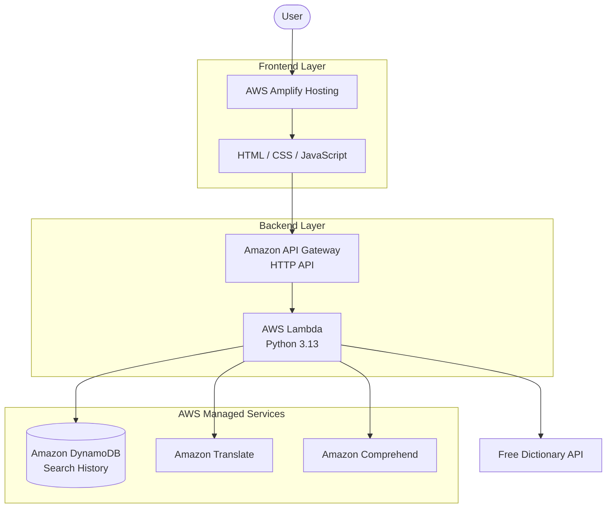
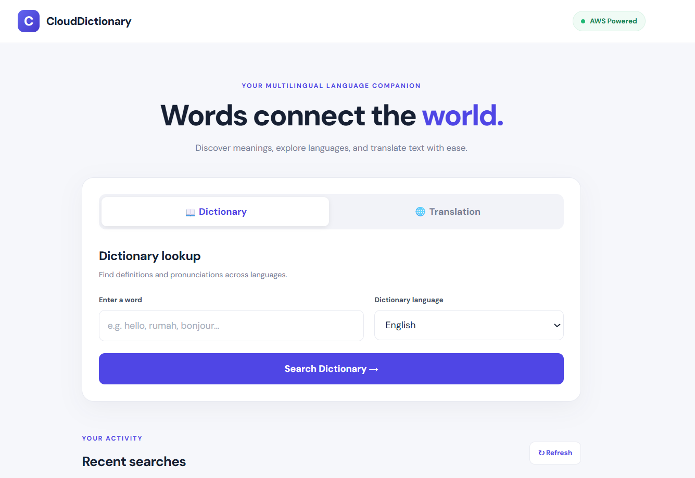
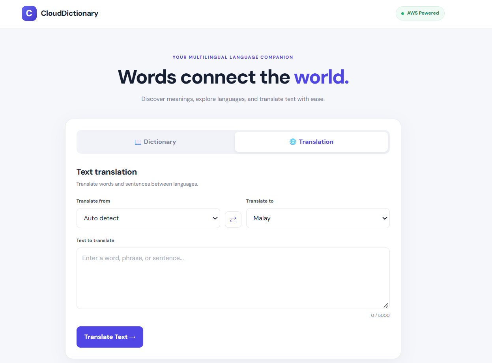
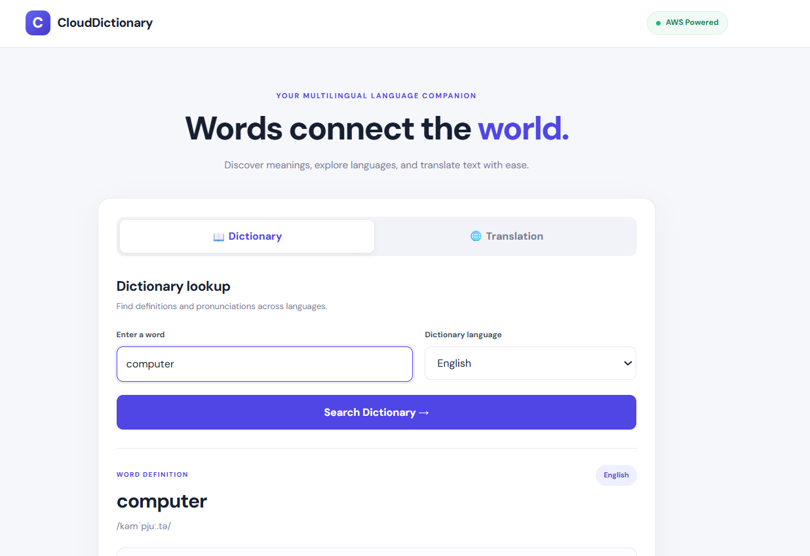
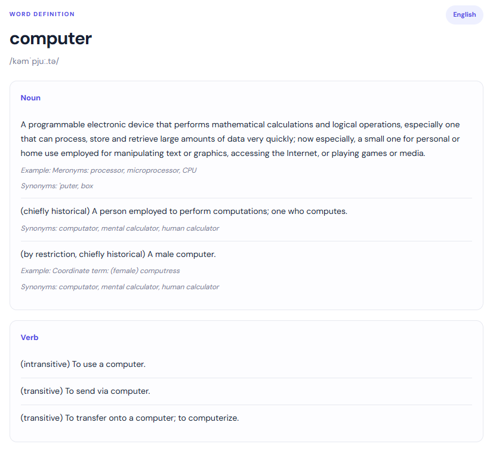
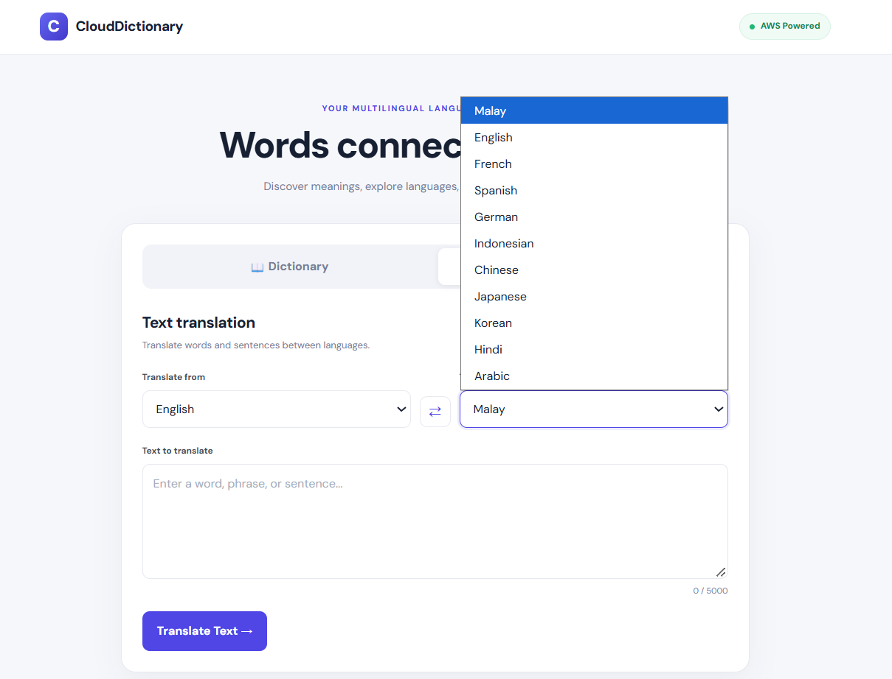
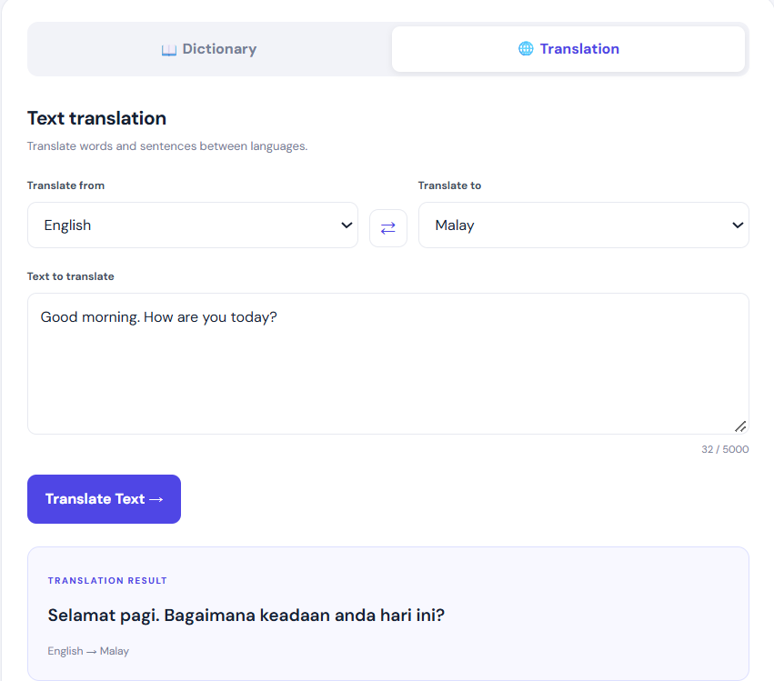
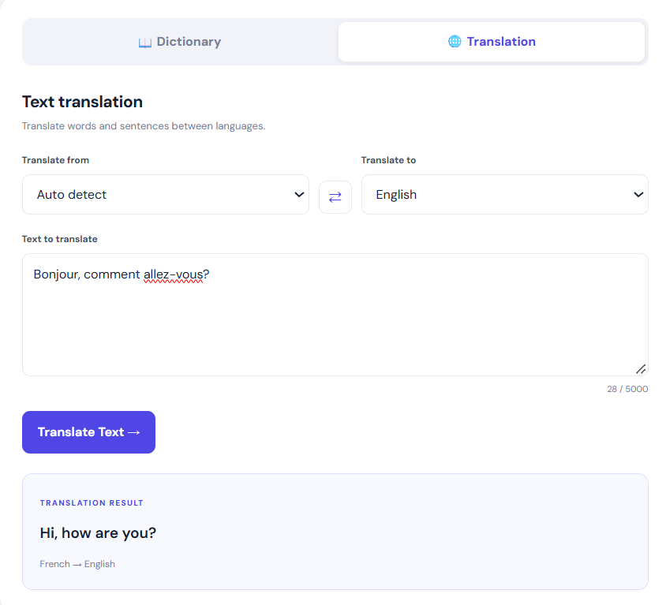
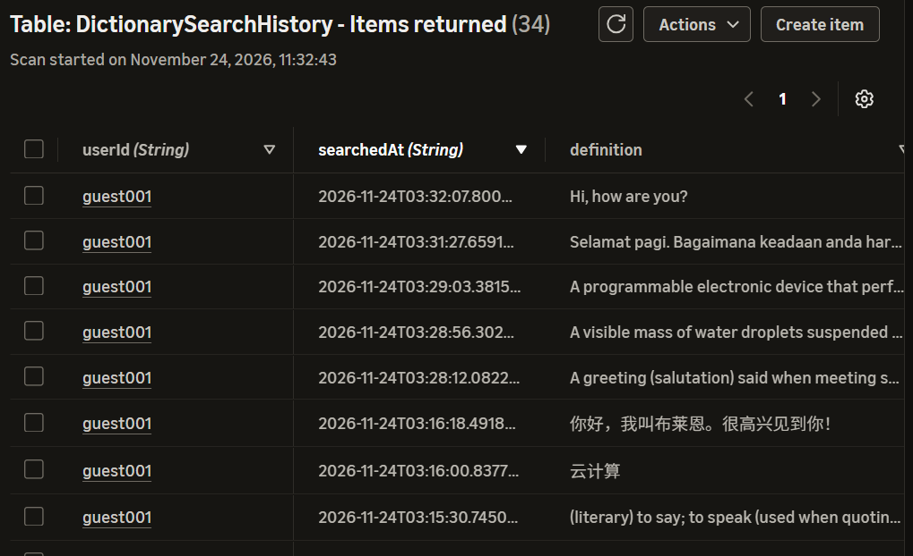

# AWS Cloud Dictionary App

A serverless, multilingual dictionary and translation web application built using AWS services. Users can search for word definitions, view phonetic pronunciations, save search history, translate text between languages, and automatically detect the source language.

**Live Application:** https://main.d982med8yigaz.amplifyapp.com/

**GitHub Repository:** https://github.com/bryanwork6099/AWS-Cloud-Dictionary-App

---

## 1. Project Overview

The AWS Cloud Dictionary App is a cloud-based application designed to demonstrate how multiple AWS managed services can work together to build a serverless web application.

The application provides two main functions:

- **Dictionary:** Search for words and retrieve definitions, phonetic pronunciations, and meanings in supported languages.
- **Translation:** Translate text between supported languages, with automatic source-language detection.

The application uses Amazon API Gateway to expose backend endpoints, AWS Lambda to process requests, and Amazon DynamoDB to store search and translation history.

Amazon Translate and Amazon Comprehend provide the translation and language detection capabilities.

## 2. Architecture

### Architecture Diagram



### Architecture Workflow

1. Users access the application through the AWS Amplify-hosted frontend.
2. The frontend sends HTTP requests to Amazon API Gateway.
3. API Gateway forwards requests to the AWS Lambda function.
4. Lambda processes the request according to the requested operation.
5. Dictionary requests retrieve word information from the Free Dictionary API.
6. Translation requests use Amazon Translate.
7. When automatic language detection is selected, Amazon Comprehend identifies the source language.
8. Search and translation records are stored in Amazon DynamoDB.
9. Lambda returns the processed response to the frontend for display.

## 3. AWS Services and Technologies

| Service / Technology | Purpose |
|---|---|
| AWS Amplify | Frontend hosting and deployment |
| Amazon API Gateway | HTTP API endpoints |
| AWS Lambda | Serverless backend processing |
| Amazon DynamoDB | Stores dictionary search and translation history |
| Amazon Translate | Text translation |
| Amazon Comprehend | Automatic language detection |
| AWS IAM | Permissions and access management |
| Python 3.13 | Lambda backend development |
| HTML5 | Frontend structure |
| CSS3 | Frontend styling |
| JavaScript | Frontend functionality |
| Free Dictionary API | Dictionary definitions and phonetic information |

## 4. Application Features

### 4.1 Dictionary Search

Users can search for words and retrieve:

- Word definitions
- Phonetic pronunciation
- Parts of speech
- Multiple meanings and definitions
- Language-specific dictionary results

Dictionary data is retrieved through the Free Dictionary API.

### 4.2 Search History

The application stores previous dictionary searches in Amazon DynamoDB.

Stored information includes:

- User identifier
- Search timestamp
- Original word
- Definition
- Selected language
- Language name

### 4.3 Multilingual Translation

Users can translate text between supported languages using Amazon Translate.

The application supports the following language codes:

| Language | Code |
|---|---|
| English | en |
| Malay | ms |
| French | fr |
| Spanish | es |
| German | de |
| Indonesian | id |
| Chinese | zh |
| Japanese | ja |
| Korean | ko |
| Hindi | hi |
| Arabic | ar |

### 4.4 Automatic Language Detection

Users can select automatic source-language detection instead of manually selecting the input language.

Amazon Comprehend detects the dominant language, and the detected language is passed to Amazon Translate.

For example:

- Input: `Bonjour, comment allez-vous?`
- Detected language: French
- Target language: English
- Translation: `Hi, how are you?`

### 4.5 Translation History

Translation requests are also recorded in Amazon DynamoDB.

Stored information includes:

- Original text
- Translated text
- Source language
- Target language
- Translation timestamp

## 5. Application Screenshots

The following screenshots show the deployed application's interface and its main features.

| Screenshot | Description |
|---|---|
|  | Homepage overview — first section |
|  | Homepage overview — second section |
|  | Dictionary search interface |
|  | Dictionary result with definitions and pronunciation |
|  | Translation mode and language selectors |
|  | Translated text result |
|  | Automatic source-language detection |
|  | Dictionary and translation history stored in DynamoDB |

## 6. API Endpoints

**API Base URL**

```text
https://tulprrnpb5.execute-api.ap-southeast-1.amazonaws.com
```

The application uses the following HTTP API routes:

| Method | Endpoint | Description |
|---|---|---|
| GET | `/dictionary` | Retrieves dictionary information |
| POST | `/history` | Retrieves search and translation history |
| POST | `/translate` | Translates text between languages |

### 6.1 Dictionary Endpoint

Example request:

```http
GET /dictionary?word=hello&language=en
```

Retrieves dictionary information for the requested word and language.

### 6.2 History Endpoint

Example request:

```http
POST /history?userId=guest001
```

Retrieves the user's stored history from DynamoDB.

### 6.3 Translation Endpoint

Example request:

```http
POST /translate
Content-Type: application/json
```

Request body:

```json
{
  "text": "Good morning. How are you today?",
  "sourceLanguage": "en",
  "targetLanguage": "ms",
  "userId": "guest001"
}
```

Example response:

```json
{
  "originalText": "Good morning. How are you today?",
  "translatedText": "Selamat pagi. Bagaimana keadaan anda hari ini?",
  "sourceLanguage": "en",
  "sourceLanguageName": "English",
  "targetLanguage": "ms",
  "targetLanguageName": "Malay"
}
```

For automatic detection, set `sourceLanguage` to `auto`.

## 7. DynamoDB Data Storage

**Table Name:** `DictionarySearchHistory`

**Primary Key Configuration:**

| Key | Attribute | Type |
|---|---|---|
| Partition Key | userId | String |
| Sort Key | searchedAt | String |

The application uses on-demand billing.

The table stores both dictionary searches and translation records.

Example dictionary record:

```json
{
  "userId": "guest001",
  "searchedAt": "2026-11-24T03:00:00Z",
  "type": "dictionary",
  "word": "hello",
  "language": "en"
}
```

Example translation record:

```json
{
  "userId": "guest001",
  "searchedAt": "2026-11-24T03:05:00Z",
  "type": "translation",
  "word": "Good morning",
  "definition": "Selamat pagi",
  "sourceLanguage": "en",
  "language": "ms",
  "languageName": "Malay"
}
```

*The examples above illustrate the record structure; actual timestamps and values depend on user activity.*

## 8. IAM Security and Permissions

AWS IAM is used to control access between the Lambda function and other AWS services.

### Lambda Execution Role

The Lambda execution role includes the following permissions:

| IAM Policy | Purpose |
|---|---|
| AWSLambdaBasicExecutionRole | CloudWatch logging |
| CloudDictionaryDynamoDBAccess | DynamoDB access |
| CloudDictionaryTranslatePolicy | Amazon Translate and Comprehend access |

### Translation Policy

The translation policy grants the Lambda function access to:

- `translate:TranslateText`
- `comprehend:DetectDominantLanguage`

The Lambda function also requires appropriate DynamoDB permissions to store and retrieve application records.

API Gateway is granted permission to invoke the Lambda function through its resource-based policy.

**Security considerations:**

- Never expose AWS access keys or secret keys in frontend JavaScript.
- Keep AWS service permissions restricted to the required actions and resources wherever possible.
- Review IAM policies regularly.
- Configure CORS to allow only the required frontend origins.
- Avoid using a shared guest identifier for applications that require real user separation or authentication.

## 9. Project Structure

```text
AWS-Cloud-Dictionary-App/
│
├── frontend/
│   ├── index.html
│   ├── style.css
│   ├── script.js
│   └── translate-policy.json
│
├── screenshots/
│   ├── 01-homepage-01.png
│   ├── 02-homepage-02.png
│   ├── 03-dictionary-search.png
│   ├── 04-dictionary-result.png
│   ├── 05-translation-interface.png
│   ├── 06-translation-result.png
│   ├── 07-translation-detection.png
│   └── 08-dynamodb-history.png
│
├── backup/
│   ├── lambda_before_translate.zip
│   ├── lambda_with_translate.zip
│   └── frontend backups
│
├── cors.json
└── README.md
```

The backup directory contains development backups and is not required for the live frontend deployment.

## 10. Deployment

### Prerequisites

Before deploying the project, prepare:

- An AWS account
- AWS CLI
- Python 3.13
- Git
- A GitHub repository
- An AWS IAM user or role with the required deployment permissions

### Step 1: Create the DynamoDB Table

Create a DynamoDB table named:

```text
DictionarySearchHistory
```

Configure:

- Partition key: `userId` (String)
- Sort key: `searchedAt` (String)
- Billing mode: On-demand

### Step 2: Create the Lambda Function

Create a Python 3.13 Lambda function named:

```text
CloudDictionaryFunction
```

Configure its execution role and environment variable:

```text
TABLE_NAME=DictionarySearchHistory
```

Deploy the Python backend code and attach the required IAM permissions.

### Step 3: Configure Amazon API Gateway

Create an HTTP API named:

```text
CloudDictionaryAPI
```

Configure the following routes:

```text
GET  /dictionary
POST /history
POST /translate
```

Integrate all three routes with the `CloudDictionaryFunction` Lambda function.

Ensure API Gateway has permission to invoke Lambda for each route.

### Step 4: Configure CORS

Configure the HTTP API to allow the required frontend origins.

Example configuration:

```json
{
  "AllowOrigins": [
    "https://main.d982med8yigaz.amplifyapp.com",
    "http://localhost:8000"
  ],
  "AllowMethods": [
    "GET",
    "POST",
    "OPTIONS"
  ],
  "AllowHeaders": [
    "Content-Type"
  ],
  "AllowCredentials": false,
  "MaxAge": 300
}
```

### Step 5: Deploy the Frontend

Connect the GitHub repository to AWS Amplify.

Configure the application root directory as:

```text
frontend
```

Amplify will host the frontend and automatically deploy updates when changes are pushed to the connected GitHub branch.

### Step 6: Configure the Frontend API URL

Ensure the frontend JavaScript points to the correct API Gateway invoke URL.

Example:

```javascript
const API_BASE_URL =
    "https://tulprrnpb5.execute-api.ap-southeast-1.amazonaws.com";
```

### Step 7: Test the Application

Verify:

1. Dictionary search returns definitions.
2. Phonetic pronunciation and meanings are displayed.
3. Search history is saved and retrieved.
4. English-to-Malay translation works.
5. Automatic language detection works.
6. Translation history is saved.
7. The deployed Amplify website works correctly.

## 11. Testing and Validation

The following tests were completed successfully.

| Test | Expected Result | Status |
|---|---|---|
| Dictionary search | Word definitions returned | Passed |
| Dictionary history | Records stored in DynamoDB | Passed |
| English to Malay | Translation returned | Passed |
| French auto-detection | French detected correctly | Passed |
| French to English | English translation returned | Passed |
| API Gateway integration | All three routes operational | Passed |
| Frontend functionality | Dictionary and translation work | Passed |
| Amplify deployment | Live application operational | Passed |

### Translation Test Examples

**Test 1: English to Malay**

Input:

```text
Good morning. How are you today?
```

Output:

```text
Selamat pagi. Bagaimana keadaan anda hari ini?
```

**Test 2: Automatic French Detection**

Input:

```text
Bonjour, comment allez-vous?
```

Detected source language:

```text
French (fr)
```

Translated output:

```text
Hi, how are you?
```

## 12. Cost Considerations

This project uses AWS managed services that may incur charges.

| AWS Service | Cost Consideration |
|---|---|
| AWS Amplify | Hosting and build usage |
| Amazon API Gateway | API request usage |
| AWS Lambda | Requests and execution duration |
| Amazon DynamoDB | On-demand read and write requests |
| Amazon Translate | Text translation usage |
| Amazon Comprehend | Language detection usage |
| Amazon CloudWatch | Log ingestion and storage |

Important considerations:

- Amazon Translate charges based on translation usage.
- Amazon Comprehend charges based on usage.
- DynamoDB on-demand billing depends on actual requests.
- Lambda and API Gateway usage may incur charges beyond applicable free allowances.
- Monitor AWS Billing and Cost Explorer regularly.

Always check the current AWS pricing for your region before deploying or increasing usage.

## 13. Future Improvements

Potential enhancements include:

- User authentication with Amazon Cognito.
- Individual user search history.
- More language support.
- Text-to-speech pronunciation.
- Improved dictionary search and filtering.
- Pagination for search history.
- Infrastructure as Code using AWS SAM or Terraform.
- Automated deployment through a CI/CD pipeline.
- Enhanced monitoring and application logging.

## 14. Learning Outcomes

Through this project, I gained practical experience with:

- Designing and deploying serverless architectures on AWS.
- Building REST-style HTTP APIs using Amazon API Gateway.
- Developing Python-based AWS Lambda functions.
- Integrating multiple AWS managed services.
- Storing application data using Amazon DynamoDB.
- Implementing text translation using Amazon Translate.
- Implementing automatic language detection using Amazon Comprehend.
- Configuring IAM execution roles and resource-based permissions.
- Configuring CORS for frontend and backend communication.
- Hosting and deploying applications using AWS Amplify.
- Integrating GitHub with AWS Amplify for automated frontend deployment.
- Troubleshooting API Gateway, Lambda, IAM, and CloudWatch issues.

## 15. Author

**Project:** AWS Cloud Dictionary App

**Developer:** Bryan

**GitHub:** https://github.com/bryanwork6099

**Live Application:** https://main.d982med8yigaz.amplifyapp.com/

---

*This project was developed as a hands-on AWS cloud portfolio project to demonstrate practical experience in serverless application development, cloud integration, database management, and managed AI services.*
